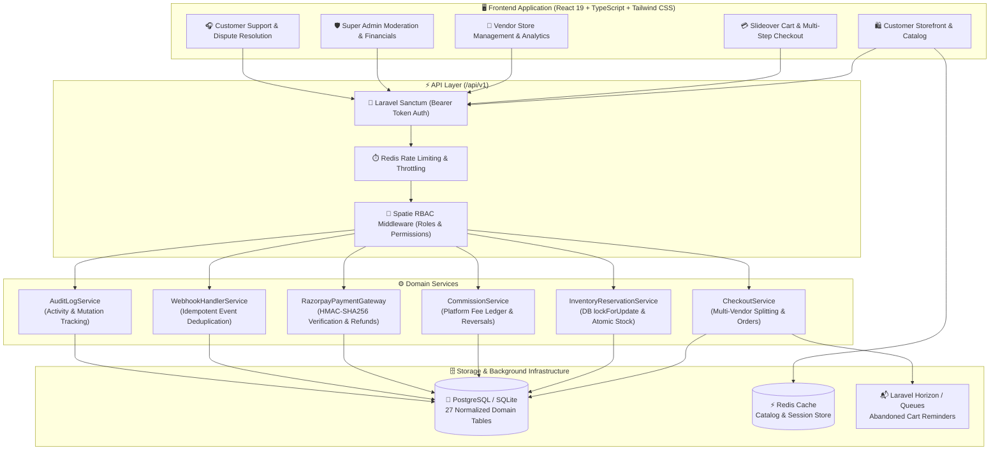
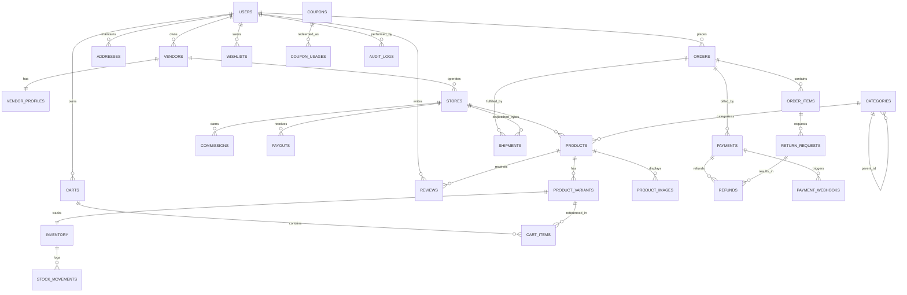
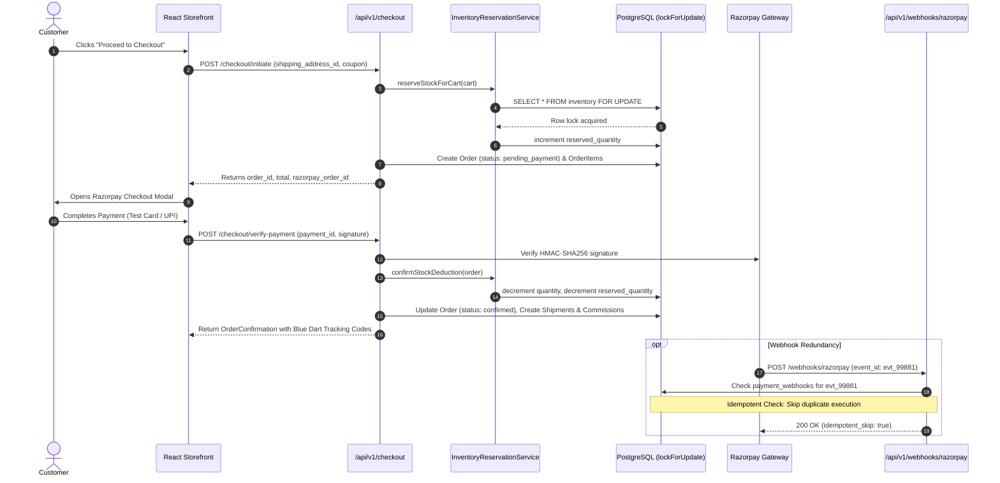

# 🛍️ NexCart – Enterprise Multi-Vendor E-Commerce Marketplace

<p align="center">
  
</p>

<p align="center">
  <strong>A production-ready, high-concurrency multi-vendor e-commerce marketplace built on Laravel 13, PHP 8.3+, PostgreSQL, Redis, and React + TypeScript.</strong>
</p>

<p align="center">
  <a href="https://github.com/muthupriyadarshan-fullstack/nexcart-marketplace/actions"></a>
  <a href="https://laravel.com"></a>
  <a href="https://www.php.net"></a>
  <a href="https://react.dev"></a>
  <a href="https://www.typescriptlang.org"></a>
  <a href="https://tailwindcss.com"></a>
  <a href="https://pestphp.com"></a>
  <a href="LICENSE"></a>
</p>

---

## 🌟 Executive Overview

**NexCart** is an enterprise-grade multi-vendor e-commerce platform architected to solve real-world e-commerce challenges: **multi-vendor order splitting, atomic stock reservation with row-level database locking to eliminate overselling under high concurrency, automated platform commission ledgers, server-side payment gateway orchestration (Razorpay test mode), idempotent webhook deduplication, and isolated role-based portals**.

The system features:
- **Zero Mock UI**: Every single dashboard statistic, inventory level, order status, commission report, and payment verification interacts directly with live `/api/v1` RESTful endpoints.
- **1-Click Role Switcher**: Instant switching between **Super Admin**, **Vendor 1 (Apex Electronics)**, **Vendor 2 (Desi Weaves)**, **Customer (Priya Sharma)**, and **Support Staff** directly from the header navigation.
- **Realistic Indian Marketplace Demo Data**: Built-in support for Indian Rupee (`₹`), GSTIN tax identification, PAN, IFSC codes, Indian shipping addresses, and mock Blue Dart logistics tracking.

---

## 🏗️ System Architecture



---

## 👥 Demo User Credentials & Role Matrix

The application seeds a realistic marketplace ecosystem ready to test out of the box. Use the **Quick Demo Role Switcher** dropdown in the top-right corner of the navbar or sign in with:

| Role | Name | Email | Password | Primary Capabilities |
| :--- | :--- | :--- | :--- | :--- |
| **Super Admin** | Rajesh Kumar (Platform Owner) | `admin@nexcart.in` | `password` | Vendor approval, product moderation, commission configuration, platform GMV analytics, audit logs. |
| **Vendor 1** | Apex Electronics Store | `apex@nexcart.in` | `password` | Product & variant CRUD, live stock adjustments, low inventory alerts, order fulfillment, payout history. |
| **Vendor 2** | Desi Weaves Handloom | `desiweaves@nexcart.in` | `password` | Handcrafted textile management, variant pricing, order dispatching, store analytics. |
| **Customer 1** | Priya Sharma | `customer@nexcart.in` | `password` | Browsing, search, wishlist, cart, coupon application (`WELCOME10`), multi-vendor checkout, returns. |
| **Customer 2** | Arjun Patel | `arjun@nexcart.in` | `password` | Verified customer profile, past orders, reviews & ratings. |
| **Support Staff** | Neha Verma (Resolution Lead) | `support@nexcart.in` | `password` | Cross-vendor order inspection, return dispute moderation, refund trigger. |

---

## 🚀 Advanced Backend Engineering Highlights

### 1. Atomic Stock Reservation (`lockForUpdate`)
To prevent overselling during flash sales and high-traffic events, NexCart implements pessimistic row-level locking inside strict database transactions:
- **Hold Period**: Stock is temporarily shifted from `quantity` to `reserved_quantity` during checkout initialization.
- **Auto-Release / Deduction**: When payment is verified via HMAC signature or webhook, reserved stock is permanently deducted. If checkout is cancelled or times out, reserved stock is atomically restored.
```php
// app/Services/InventoryReservationService.php
$inventory = Inventory::where('product_variant_id', $variantId)
    ->lockForUpdate()
    ->firstOrFail();

if (($inventory->quantity - $inventory->reserved_quantity) < $requestedQty) {
    throw new InsufficientStockException("Insufficient stock available.");
}
$inventory->increment('reserved_quantity', $requestedQty);
```

### 2. Multi-Vendor Order Splitting & Commission Ledger
A customer can purchase products from multiple independent stores in a single checkout:
- **Order Level**: Parent order record with single payment reference (`NEX-202611-XXXX`).
- **Vendor Splitting**: Individual `order_items` tagged with store IDs and segregated `shipments` with distinct Blue Dart tracking codes.
- **Financial Ledger**: The `CommissionService` automatically calculates platform cut (e.g. 10%) and vendor net receivable, recorded in the `commissions` ledger table.

### 3. Razorpay Payment Adapter & HMAC Verification
Server-side verification confirms payment authenticity before order confirmation:
- Computes `hash_hmac('sha256', $orderId . "|" . $paymentId, $secret)`.
- Validates against `razorpay_signature` submitted by the client.
- Automatically handles test mode transactions and initiates test refunds.

### 4. Idempotent Webhook Processing
Payment gateway webhooks are protected against duplicate delivery and replay attacks:
- Every event is recorded in the `payment_webhooks` table with its unique gateway `event_id`.
- Duplicate webhook payloads receive an immediate `200 OK` acknowledgment with `{ "idempotent_skip": true }` to avoid double-crediting or duplicate stock deductions.

### 5. Scheduled Abandoned Cart Recovery
- Console command: `php artisan cart:abandoned-reminders` (scheduled in `routes/console.php`).
- Queries open carts inactive for > 2 hours with stock reservations, dispatches queued `AbandonedCartNotification` reminders, and prevents stale inventory holds.

---

## 🗄️ Database Architecture & Entity Relationships

The schema consists of 27 normalized tables designed with foreign key constraints, cascade rules, composite indexes, and audit logging.



---

## 🔄 Multi-Vendor Checkout State Machine



---

## 📡 REST API Reference

The complete OpenAPI 3.0 specification is available at [docs/openapi_v1.yaml](docs/openapi_v1.yaml).

### Public & Authentication
- `POST /api/v1/auth/register` – Customer registration with Sanctum token.
- `POST /api/v1/auth/vendor-register` – Vendor onboarding with tax (GST/PAN) and bank details.
- `POST /api/v1/auth/login` – Authentication and token generation.
- `GET  /api/v1/auth/me` – Current authenticated user profile and roles.
- `POST /api/v1/auth/logout` – Revoke active Sanctum token.

### Catalog & Browsing (Redis Cached)
- `GET  /api/v1/categories` – Hierarchical category tree.
- `GET  /api/v1/categories/{slug}` – Category detail with subcategories.
- `GET  /api/v1/products` – Paginated catalog with full-text search, filters (price range, category, brand), and sorting.
- `GET  /api/v1/products/{slug}` – Full product detail with variants, images, live inventory, and reviews.

### Customer Cart, Wishlist & Addresses
- `GET    /api/v1/cart` – View active cart with vendor breakdown and applied coupons.
- `POST   /api/v1/cart/items` – Add product variant with stock availability check.
- `PATCH  /api/v1/cart/items/{id}` – Update item quantity.
- `DELETE /api/v1/cart/items/{id}` – Remove item from cart.
- `POST   /api/v1/cart/coupon` – Validate and apply promotional coupon code.
- `DELETE /api/v1/cart/coupon` – Remove coupon code.
- `GET    /api/v1/wishlist` & `POST /api/v1/wishlist/toggle` – Customer wishlist toggle.
- `GET    /api/v1/addresses` & `POST /api/v1/addresses` – Customer delivery address book.

### Checkout & Order Lifecycle
- `POST /api/v1/checkout/initiate` – Atomic stock reservation and order creation.
- `POST /api/v1/checkout/verify-payment` – Server-side HMAC verification, stock deduction, shipment creation.
- `GET  /api/v1/orders` – Customer order history.
- `GET  /api/v1/orders/{orderNumber}` – Order details, vendor-segregated shipments, tracking codes.
- `POST /api/v1/orders/{orderNumber}/return` – Submit return request for an order item.
- `POST /api/v1/products/{slug}/reviews` – Submit verified purchase review and star rating.

### Vendor Portal (`role:vendor`)
- `GET   /api/v1/vendor/dashboard` – Real-time sales, order stats, low stock alerts, earnings.
- `GET   /api/v1/vendor/products` – Vendor's catalog items.
- `POST  /api/v1/vendor/products` – Create new product with variants and initial inventory.
- `PATCH /api/v1/vendor/inventory/{variantId}` – Direct inventory adjustment with audit movement.
- `GET   /api/v1/vendor/orders` – Vendor-specific order items and fulfillment statuses.
- `PATCH /api/v1/vendor/shipments/{id}/status` – Dispatch shipment with tracking number.
- `GET   /api/v1/vendor/earnings` – Commission earnings breakdown and platform payout ledger.

### Admin Portal (`role:super-admin`)
- `GET   /api/v1/admin/dashboard` – Platform GMV, total orders, active vendors, fee revenue.
- `GET   /api/v1/admin/vendors` – Vendor application list.
- `PATCH /api/v1/admin/vendors/{id}/approve` – Approve vendor and activate storefront.
- `GET   /api/v1/admin/products/moderation` – Pending product catalog submissions.
- `PATCH /api/v1/admin/products/{id}/moderate` – Approve or reject with reason.
- `GET   /api/v1/admin/coupons` & `POST /api/v1/admin/coupons` – Platform coupon management.
- `GET   /api/v1/admin/refunds` & `POST /api/v1/admin/refunds/{id}/process` – Process refunds, restock, and reverse commissions.
- `GET   /api/v1/admin/audit-logs` – Audit trail of all administrative and vendor operations.

### Support Portal (`role:support-staff`)
- `GET   /api/v1/support/orders` – Global order lookup across all vendors.
- `GET   /api/v1/support/returns` – Return requests queue.
- `PATCH /api/v1/support/returns/{id}/decision` – Approve or decline return dispute.

### Webhook Endpoints
- `POST /api/v1/webhooks/razorpay` – Idempotent payment gateway webhook receiver.

---

## 🛠️ Local Development Quickstart

### Prerequisites
- **PHP 8.3+** with extensions: `pdo_pgsql` (or `pdo_sqlite`), `pgsql`, `redis`, `intl`, `gd`, `zip`, `bcmath`.
- **Composer 2.x**
- **Node.js 22.x** & **npm 10.x**

### 1. Clone & Setup Environment
```bash
git clone https://github.com/muthupriyadarshan-fullstack/nexcart-marketplace.git
cd nexcart-marketplace

# Copy environment configuration
cp .env.example .env

# Install PHP dependencies
composer install

# Install Node dependencies
npm install
```

### 2. Database Migration & Realistic Seeding
```bash
# Generate encryption key
php artisan key:generate

# Run migrations and seed roles, demo vendors, categories, products, coupons & orders
php artisan migrate:fresh --seed
```

### 3. Build Frontend & Launch Server
```bash
# Build React + Tailwind production bundle
npm run build

# Start Laravel development server
php artisan serve
```
Visit **[http://localhost:8000](http://localhost:8000)** in your browser!

---

## 🐳 Docker Compose Deployment

A complete production-style multi-container Docker setup is included:
- **`app`**: PHP 8.3-FPM with PostgreSQL, Redis, BCMath, and OPcache.
- **`web`**: Nginx web server with gzip and security headers.
- **`postgres`**: PostgreSQL 16 database.
- **`redis`**: Redis 7 cache and queue driver.
- **`queue`**: Dedicated Laravel queue worker container.
- **`mailpit`**: SMTP mock server and web UI for notifications.

```bash
# Start all containers in the background
docker compose up -d

# Run database migrations and seed realistic demo data inside the app container
docker compose exec app php artisan migrate:fresh --seed

# Access the application
# Web App:  http://localhost:8080
# Mailpit:  http://localhost:8025
```

---

## 🧪 Automated Testing Suite

The project includes tests written with **Pest PHP** covering authentication, Spatie RBAC role boundaries, vendor product isolation, cart stock checks, atomic checkout reservation, payment verification, duplicate webhook idempotency, and refund inventory restock:

```bash
# Run all Pest feature and unit tests
php artisan test
```

### Test Coverage Summary:
```
   PASS  Tests\Unit\ExampleTest
  ✓ that true is true

   PASS  Tests\Feature\ExampleTest
  ✓ the application returns a successful response

   PASS  Tests\Feature\AuthTest
  ✓ customer can register and receives sanctum bearer token
  ✓ vendor can onboard with store and tax information
  ✓ user cannot login with incorrect password
  ✓ role permissions block regular customer from vendor portal

   PASS  Tests\Feature\VendorProductIsolationTest
  ✓ vendor can create product with variants and initial stock
  ✓ vendor cannot modify or access another vendors product

   PASS  Tests\Feature\CartAndCheckoutTest
  ✓ customer can add product variant to cart
  ✓ cannot add quantity exceeding available stock
  ✓ checkout initialization atomically reserves stock and creates order
  ✓ payment verification permanently deducts reserved stock and clears cart

   PASS  Tests\Feature\PaymentAndWebhookIdempotencyTest
  ✓ duplicate webhook events are processed idempotently
  ✓ refund processing reverses commission and restocks inventory

  Tests:    14 passed (57 assertions)
  Duration: 1.72s
```

---

## 📁 Repository Directory Structure

```
nexcart-marketplace/
├── app/
│   ├── Console/Commands/SendAbandonedCartReminders.php
│   ├── Http/
│   │   ├── Controllers/Api/V1/         # 12 RESTful API Controllers
│   │   ├── Requests/                   # Form Request Validation Classes
│   │   └── Resources/                  # Eloquent API JSON Resources
│   ├── Models/                         # 27 Eloquent Domain Models
│   ├── Notifications/                  # Queued Abandoned Cart Notifications
│   └── Services/                       # Core Domain Services
│       ├── AuditLogService.php
│       ├── CheckoutService.php
│       ├── CommissionService.php
│       ├── InventoryReservationService.php
│       ├── PaymentGatewayInterface.php
│       ├── RazorpayPaymentGateway.php
│       ├── RefundService.php
│       └── WebhookHandlerService.php
├── config/                             # Framework & Service Configurations
├── database/
│   ├── migrations/                     # 7 Normalized Domain Migrations
│   └── seeders/                        # Roles, Permissions & Indian Demo Data
├── docker/
│   ├── nginx/default.conf
│   └── php/local.ini
├── docs/
│   ├── architecture_and_schema.md      # Architectural Deep-Dive & ER Notes
│   └── openapi_v1.yaml                 # Complete OpenAPI 3.0 API Catalog
├── resources/
│   ├── js/
│   │   ├── components/                 # React Storefront, Modals & Portals
│   │   │   ├── AdminDashboardView.tsx
│   │   │   ├── AuthModal.tsx
│   │   │   ├── CartDrawer.tsx
│   │   │   ├── CheckoutModal.tsx
│   │   │   ├── CustomerOrdersView.tsx
│   │   │   ├── CustomerStorefront.tsx
│   │   │   ├── Navbar.tsx
│   │   │   ├── OrderConfirmationModal.tsx
│   │   │   ├── ProductDetailModal.tsx
│   │   │   ├── SupportDashboardView.tsx
│   │   │   └── VendorDashboardView.tsx
│   │   ├── app.tsx                     # React 19 Application Root
│   │   └── types.ts                    # TypeScript Interfaces
│   └── views/
│       └── welcome.blade.php           # SPA Single Page Shell
├── routes/
│   ├── api.php                         # 67 Versioned API Endpoints (/api/v1)
│   ├── web.php                         # SPA Fallback Route
│   └── console.php                     # Scheduled Tasks & Cart Reminders
├── tests/
│   ├── Feature/                        # Pest Feature Tests
│   └── Unit/                           # Pest Unit Tests
├── .github/workflows/ci.yml            # Automated GitHub Actions Workflow
├── docker-compose.yml                  # Production-ready Multi-Container Setup
├── Dockerfile                          # Optimized PHP 8.3-FPM Container
└── README.md                           # Documentation & Developer Showcase
```

---

## 📜 License & Acknowledgments

This project is licensed under the [MIT License](LICENSE). Built for developers seeking a production-grade reference architecture for multi-vendor e-commerce with Laravel, PostgreSQL, Redis, and React.
