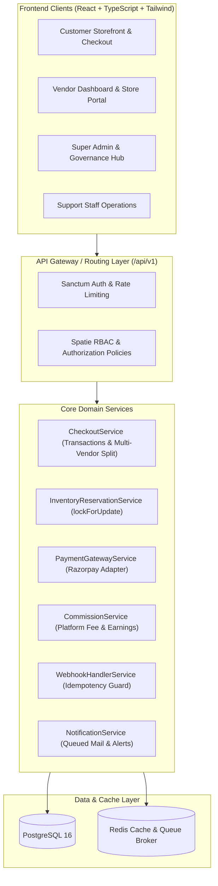
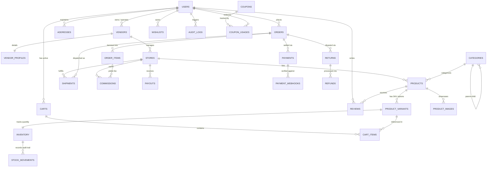

# NexCart – Multi-Vendor E-Commerce Marketplace
## Architecture & Database Schema Specification

### 1. Architectural Overview

NexCart is an enterprise-grade multi-vendor e-commerce marketplace built using Laravel (PHP 8.3+), PostgreSQL, Redis, and React + TypeScript + Tailwind CSS. The system decouples backend services via a versioned RESTful API (`/api/v1`), secured with Laravel Sanctum tokens and Spatie Role-Based Access Control (RBAC).

---

### 2. Multi-Vendor Domain Model & Entity-Relationship Design

---

### 3. Detailed Database Schema & Constraints

#### 3.1 Authentication & Users (`users`, `roles`, `permissions`)
- `id`: BigSerial Primary Key
- `name`: VARCHAR(255) NOT NULL
- `email`: VARCHAR(255) UNIQUE NOT NULL
- `phone`: VARCHAR(20) NULL
- `password`: VARCHAR(255) NOT NULL
- `status`: ENUM ('active', 'suspended', 'pending') DEFAULT 'active'
- `email_verified_at`: TIMESTAMP NULL
- `created_at`, `updated_at`: TIMESTAMP

#### 3.2 Vendors & Stores (`vendors`, `vendor_profiles`, `stores`)
- **`vendors`**:
  - `id`: BigSerial PK
  - `user_id`: BigInteger FK (`users.id`) ON DELETE CASCADE
  - `status`: ENUM ('pending', 'approved', 'rejected', 'suspended') DEFAULT 'pending'
  - `approved_at`: TIMESTAMP NULL
  - `approved_by`: BigInteger FK (`users.id`) NULL
- **`vendor_profiles`**:
  - `id`: BigSerial PK
  - `vendor_id`: BigInteger FK (`vendors.id`) ON DELETE CASCADE
  - `company_name`: VARCHAR(255) NOT NULL
  - `tax_id_gst`: VARCHAR(50) NOT NULL
  - `bank_account_number`: VARCHAR(50) NOT NULL
  - `bank_ifsc_code`: VARCHAR(20) NOT NULL
  - `bank_name`: VARCHAR(100) NOT NULL
  - `pan_number`: VARCHAR(20) NOT NULL
- **`stores`**:
  - `id`: BigSerial PK
  - `vendor_id`: BigInteger FK (`vendors.id`) ON DELETE CASCADE
  - `name`: VARCHAR(255) NOT NULL
  - `slug`: VARCHAR(255) UNIQUE NOT NULL
  - `description`: TEXT NULL
  - `logo_url`: VARCHAR(500) NULL
  - `banner_url`: VARCHAR(500) NULL
  - `commission_rate`: DECIMAL(5,2) DEFAULT 10.00 -- 10% default platform fee
  - `status`: ENUM ('active', 'inactive') DEFAULT 'active'

#### 3.3 Catalog & Inventory (`categories`, `products`, `product_variants`, `inventory`, `stock_movements`)
- **`categories`**:
  - `id`: BigSerial PK
  - `parent_id`: BigInteger FK (`categories.id`) ON DELETE SET NULL NULL
  - `name`: VARCHAR(150) NOT NULL
  - `slug`: VARCHAR(150) UNIQUE NOT NULL
  - `image_url`: VARCHAR(500) NULL
  - `is_active`: BOOLEAN DEFAULT TRUE
- **`products`**:
  - `id`: BigSerial PK
  - `store_id`: BigInteger FK (`stores.id`) ON DELETE CASCADE
  - `category_id`: BigInteger FK (`categories.id`) ON DELETE RESTRICT
  - `name`: VARCHAR(255) NOT NULL
  - `slug`: VARCHAR(255) UNIQUE NOT NULL
  - `brand`: VARCHAR(100) NULL
  - `short_description`: TEXT NULL
  - `description`: TEXT NOT NULL
  - `base_price`: DECIMAL(12,2) NOT NULL
  - `sale_price`: DECIMAL(12,2) NULL
  - `status`: ENUM ('draft', 'pending_moderation', 'approved', 'rejected', 'archived') DEFAULT 'pending_moderation'
  - `rejection_reason`: TEXT NULL
- **`product_images`**:
  - `id`: BigSerial PK
  - `product_id`: BigInteger FK (`products.id`) ON DELETE CASCADE
  - `image_url`: VARCHAR(500) NOT NULL
  - `is_primary`: BOOLEAN DEFAULT FALSE
  - `sort_order`: INT DEFAULT 0
- **`product_variants`**:
  - `id`: BigSerial PK
  - `product_id`: BigInteger FK (`products.id`) ON DELETE CASCADE
  - `sku`: VARCHAR(100) UNIQUE NOT NULL
  - `title`: VARCHAR(255) NOT NULL -- e.g. "Space Black / 256GB"
  - `attributes`: JSONB NOT NULL -- `{"color": "Space Black", "size": "256GB"}`
  - `price`: DECIMAL(12,2) NOT NULL
  - `compare_at_price`: DECIMAL(12,2) NULL
- **`inventory`**:
  - `id`: BigSerial PK
  - `product_variant_id`: BigInteger FK (`product_variants.id`) ON DELETE CASCADE UNIQUE
  - `quantity`: INT NOT NULL DEFAULT 0
  - `reserved_quantity`: INT NOT NULL DEFAULT 0
  - `low_stock_threshold`: INT NOT NULL DEFAULT 5
- **`stock_movements`**:
  - `id`: BigSerial PK
  - `inventory_id`: BigInteger FK (`inventory.id`) ON DELETE CASCADE
  - `type`: ENUM ('purchase', 'order_reservation', 'order_deduction', 'order_release', 'restock', 'return_restock', 'manual_adjustment')
  - `quantity_change`: INT NOT NULL
  - `balance_after`: INT NOT NULL
  - `reference_id`: VARCHAR(100) NULL -- Order ID or Batch ID
  - `notes`: VARCHAR(255) NULL

#### 3.4 Cart, Wishlist & Addresses (`carts`, `cart_items`, `wishlists`, `addresses`)
- **`carts`**:
  - `id`: BigSerial PK
  - `user_id`: BigInteger FK (`users.id`) ON DELETE CASCADE NULL
  - `session_id`: VARCHAR(100) NULL
  - `coupon_id`: BigInteger FK (`coupons.id`) NULL
  - `updated_at`: TIMESTAMP
- **`cart_items`**:
  - `id`: BigSerial PK
  - `cart_id`: BigInteger FK (`carts.id`) ON DELETE CASCADE
  - `product_variant_id`: BigInteger FK (`product_variants.id`) ON DELETE CASCADE
  - `quantity`: INT NOT NULL DEFAULT 1
  - UNIQUE(`cart_id`, `product_variant_id`)
- **`addresses`**:
  - `id`: BigSerial PK
  - `user_id`: BigInteger FK (`users.id`) ON DELETE CASCADE
  - `name`: VARCHAR(150) NOT NULL
  - `phone`: VARCHAR(20) NOT NULL
  - `address_line1`: VARCHAR(255) NOT NULL
  - `address_line2`: VARCHAR(255) NULL
  - `city`: VARCHAR(100) NOT NULL
  - `state`: VARCHAR(100) NOT NULL
  - `postal_code`: VARCHAR(20) NOT NULL
  - `country`: VARCHAR(50) DEFAULT 'India'
  - `type`: ENUM ('shipping', 'billing', 'both') DEFAULT 'both'
  - `is_default`: BOOLEAN DEFAULT FALSE

#### 3.5 Orders, Payments & Fulfillment (`orders`, `order_items`, `payments`, `payment_webhooks`, `shipments`)
- **`orders`**:
  - `id`: BigSerial PK
  - `order_number`: VARCHAR(50) UNIQUE NOT NULL -- e.g. "NEX-202611-8492"
  - `user_id`: BigInteger FK (`users.id`) ON DELETE RESTRICT
  - `shipping_address`: JSONB NOT NULL
  - `billing_address`: JSONB NOT NULL
  - `subtotal`: DECIMAL(12,2) NOT NULL
  - `discount_amount`: DECIMAL(12,2) DEFAULT 0.00
  - `tax_amount`: DECIMAL(12,2) DEFAULT 0.00
  - `shipping_fee`: DECIMAL(12,2) DEFAULT 0.00
  - `grand_total`: DECIMAL(12,2) NOT NULL
  - `currency`: VARCHAR(5) DEFAULT 'INR'
  - `status`: ENUM ('pending_payment', 'paid', 'processing', 'partially_shipped', 'shipped', 'delivered', 'cancelled', 'refunded') DEFAULT 'pending_payment'
  - `payment_status`: ENUM ('pending', 'authorized', 'captured', 'failed', 'refunded') DEFAULT 'pending'
  - `placed_at`: TIMESTAMP DEFAULT CURRENT_TIMESTAMP
- **`order_items`**:
  - `id`: BigSerial PK
  - `order_id`: BigInteger FK (`orders.id`) ON DELETE CASCADE
  - `store_id`: BigInteger FK (`stores.id`) ON DELETE RESTRICT
  - `product_variant_id`: BigInteger FK (`product_variants.id`) ON DELETE RESTRICT
  - `product_name`: VARCHAR(255) NOT NULL
  - `variant_sku`: VARCHAR(100) NOT NULL
  - `unit_price`: DECIMAL(12,2) NOT NULL
  - `quantity`: INT NOT NULL
  - `total_price`: DECIMAL(12,2) NOT NULL
  - `commission_rate`: DECIMAL(5,2) NOT NULL
  - `commission_amount`: DECIMAL(12,2) NOT NULL
  - `vendor_earnings`: DECIMAL(12,2) NOT NULL
  - `status`: ENUM ('pending', 'processing', 'shipped', 'delivered', 'cancelled', 'refunded') DEFAULT 'pending'
- **`shipments`**:
  - `id`: BigSerial PK
  - `order_id`: BigInteger FK (`orders.id`) ON DELETE CASCADE
  - `store_id`: BigInteger FK (`stores.id`) ON DELETE RESTRICT
  - `tracking_number`: VARCHAR(100) NULL
  - `carrier`: VARCHAR(100) NULL
  - `status`: ENUM ('pending', 'dispatched', 'in_transit', 'out_for_delivery', 'delivered', 'returned') DEFAULT 'pending'
  - `shipped_at`: TIMESTAMP NULL
  - `delivered_at`: TIMESTAMP NULL
- **`payments`**:
  - `id`: BigSerial PK
  - `order_id`: BigInteger FK (`orders.id`) ON DELETE RESTRICT
  - `gateway`: VARCHAR(50) DEFAULT 'razorpay'
  - `gateway_order_id`: VARCHAR(100) UNIQUE NOT NULL -- e.g. "order_RPZ..."
  - `gateway_payment_id`: VARCHAR(100) NULL
  - `gateway_signature`: VARCHAR(255) NULL
  - `amount`: DECIMAL(12,2) NOT NULL
  - `currency`: VARCHAR(5) DEFAULT 'INR'
  - `status`: ENUM ('created', 'attempted', 'captured', 'failed', 'refunded') DEFAULT 'created'
  - `idempotency_key`: VARCHAR(100) UNIQUE NOT NULL
- **`payment_webhooks`**:
  - `id`: BigSerial PK
  - `event_id`: VARCHAR(100) UNIQUE NOT NULL -- idempotency check
  - `event_type`: VARCHAR(100) NOT NULL
  - `gateway`: VARCHAR(50) DEFAULT 'razorpay'
  - `payload`: JSONB NOT NULL
  - `processed`: BOOLEAN DEFAULT FALSE
  - `processed_at`: TIMESTAMP NULL

#### 3.6 Coupons, Reviews, Returns, Commissions & Payouts
- **`coupons`**:
  - `id`: BigSerial PK
  - `code`: VARCHAR(50) UNIQUE NOT NULL
  - `discount_type`: ENUM ('percentage', 'fixed') NOT NULL
  - `discount_value`: DECIMAL(12,2) NOT NULL
  - `min_order_amount`: DECIMAL(12,2) DEFAULT 0.00
  - `max_discount_amount`: DECIMAL(12,2) NULL
  - `usage_limit_total`: INT NULL
  - `usage_limit_per_user`: INT DEFAULT 1
  - `starts_at`: TIMESTAMP NULL
  - `expires_at`: TIMESTAMP NULL
  - `is_active`: BOOLEAN DEFAULT TRUE
- **`coupon_usages`**:
  - `id`: BigSerial PK
  - `coupon_id`: BigInteger FK (`coupons.id`) ON DELETE CASCADE
  - `user_id`: BigInteger FK (`users.id`) ON DELETE CASCADE
  - `order_id`: BigInteger FK (`orders.id`) ON DELETE CASCADE
- **`reviews`**:
  - `id`: BigSerial PK
  - `product_id`: BigInteger FK (`products.id`) ON DELETE CASCADE
  - `user_id`: BigInteger FK (`users.id`) ON DELETE CASCADE
  - `order_item_id`: BigInteger FK (`order_items.id`) ON DELETE CASCADE UNIQUE -- verified purchase only
  - `rating`: SMALLINT CHECK (rating >= 1 AND rating <= 5)
  - `title`: VARCHAR(200) NULL
  - `comment`: TEXT NOT NULL
  - `is_approved`: BOOLEAN DEFAULT TRUE
- **`returns` & `refunds`**:
  - **`returns`**:
    - `id`: BigSerial PK
    - `order_item_id`: BigInteger FK (`order_items.id`) ON DELETE RESTRICT
    - `user_id`: BigInteger FK (`users.id`) ON DELETE RESTRICT
    - `reason`: VARCHAR(255) NOT NULL
    - `description`: TEXT NULL
    - `status`: ENUM ('requested', 'approved', 'rejected', 'item_received', 'completed') DEFAULT 'requested'
  - **`refunds`**:
    - `id`: BigSerial PK
    - `return_id`: BigInteger FK (`returns.id`) ON DELETE RESTRICT NULL
    - `order_id`: BigInteger FK (`orders.id`) ON DELETE RESTRICT
    - `amount`: DECIMAL(12,2) NOT NULL
    - `gateway_refund_id`: VARCHAR(100) NULL
    - `status`: ENUM ('pending', 'processed', 'failed') DEFAULT 'pending'
    - `processed_by`: BigInteger FK (`users.id`) NULL
- **`commissions` & `payouts`**:
  - **`commissions`**:
    - `id`: BigSerial PK
    - `store_id`: BigInteger FK (`stores.id`) ON DELETE RESTRICT
    - `order_item_id`: BigInteger FK (`order_items.id`) ON DELETE RESTRICT
    - `order_amount`: DECIMAL(12,2) NOT NULL
    - `commission_rate`: DECIMAL(5,2) NOT NULL
    - `platform_fee`: DECIMAL(12,2) NOT NULL
    - `net_vendor_earnings`: DECIMAL(12,2) NOT NULL
    - `status`: ENUM ('pending', 'earned', 'reversed') DEFAULT 'pending'
  - **`payouts`**:
    - `id`: BigSerial PK
    - `store_id`: BigInteger FK (`stores.id`) ON DELETE RESTRICT
    - `amount`: DECIMAL(12,2) NOT NULL
    - `status`: ENUM ('requested', 'processing', 'completed', 'rejected') DEFAULT 'requested'
    - `bank_reference`: VARCHAR(100) NULL
    - `requested_at`: TIMESTAMP DEFAULT CURRENT_TIMESTAMP
    - `processed_at`: TIMESTAMP NULL
- **`audit_logs`**:
  - `id`: BigSerial PK
  - `user_id`: BigInteger FK (`users.id`) NULL
  - `event`: VARCHAR(100) NOT NULL -- e.g. "product.approved", "order.refunded"
  - `auditable_type`: VARCHAR(100) NOT NULL
  - `auditable_id`: BigInteger NOT NULL
  - `old_values`: JSONB NULL
  - `new_values`: JSONB NULL
  - `ip_address`: VARCHAR(45) NULL
  - `user_agent`: VARCHAR(255) NULL
  - `created_at`: TIMESTAMP DEFAULT CURRENT_TIMESTAMP

---

### 4. High-Performance Concurrency & Business Rules

1. **Atomic Inventory Reservation**:
   - At checkout initialization, rows in `inventory` for each selected `product_variant_id` are locked via:
     `SELECT quantity, reserved_quantity FROM inventory WHERE product_variant_id = :id FOR UPDATE`
   - Available stock is evaluated as: `available = quantity - reserved_quantity`.
   - If `available < requested_quantity`, the transaction aborts with `HTTP 422 Unprocessable Entity (Insufficient Stock)`.
   - Upon reservation, `reserved_quantity += requested_quantity` and a reservation record with a 15-minute TTL is created.
   - On payment capture webhook, `quantity -= requested_quantity` and `reserved_quantity -= requested_quantity`.
   - If payment expires or is aborted, `reserved_quantity -= requested_quantity`.

2. **Multi-Vendor Order Segregation**:
   - A single customer cart can aggregate goods from arbitrary active vendors.
   - The master `orders` record represents the single customer charge.
   - Individual `order_items` link to their respective `store_id`.
   - Dedicated `shipments` are generated per distinct store, allowing vendors to dispatch their packages independently with individual tracking numbers.
   - Platform commissions are deducted on an item-by-item basis according to each vendor's store rate.

3. **Idempotent Webhooks & Razorpay Verification**:
   - Razorpay HMAC-SHA256 signature calculated over `$order_id . '|' . $payment_id`.
   - Every incoming webhook payload is checked against `payment_webhooks.event_id`.
   - If an event is already marked `processed = TRUE`, a fast HTTP 200 is returned immediately to prevent double ledger credits or double deductions.
